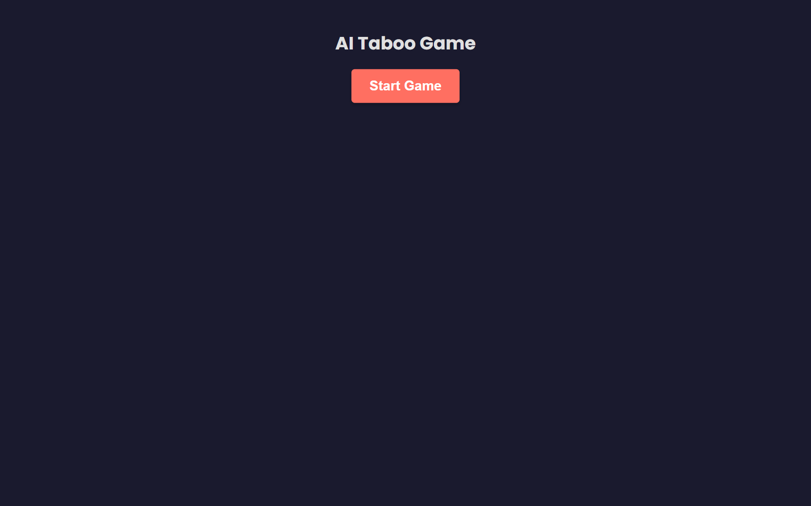
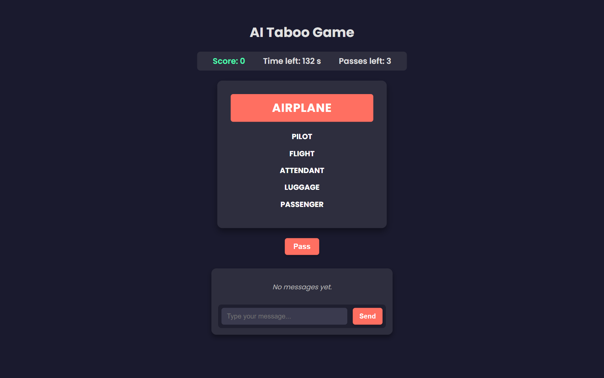
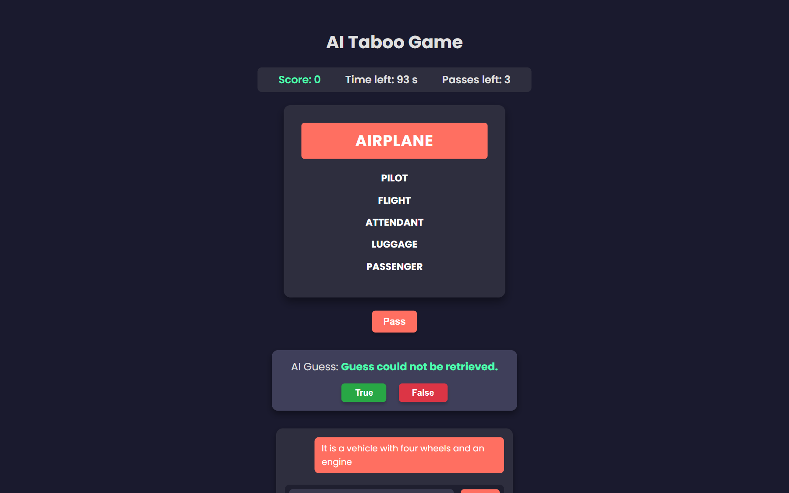

# AI Taboo Game

A local two-role Taboo game: one player sees a secret word plus its taboo
list and writes descriptions in chat; a FastAPI backend validates every
description with NLTK lemmatization (so `describing`/`described` are caught by
taboo word `describe`) and then asks Google Gemini to guess the word from the
combined description. React (Vite) frontend, REST backend, no database — game
state lives in the browser.


## What it looks like


*The start screen — dark single-page UI, no account needed.*


*A round: secret word card with its taboo list, countdown, passes and score.*


*Sending a description and the reply bubble. Captured without a Gemini key:
the fallback line "Guess could not be retrieved." is the app's documented
keyless behavior — with your own key the AI's guess appears here.*

## Game flow

1. Start game → frontend requests a random card from `Backend/taboo_words.json`
   (word + taboo list, never reusing a word within a round).
2. 60-second timer, 3 passes, per-round score kept client-side
   (`Frontend/src/App.jsx`).
3. Every chat message is POSTed to `/api/check-description`; if a taboo
   lemma is detected the message is rejected and the offending words are
   highlighted.
4. On submit, `/api/guess-word` sends the description to
   `gemini-2.5-flash-lite` (fallback: `gemini-flash-lite-latest`) and the
   guess is shown for the human referee to accept or reject.

## Backend

```bash
cd Backend
python -m venv venv
# Windows cmd: venv\Scripts\activate
# Windows PowerShell: .\venv\Scripts\Activate.ps1
# Linux / macOS: source venv/bin/activate
pip install -r requirements.txt
```

Create `Backend/.env` (read via python-dotenv at import time):

```env
GOOGLE_API_KEY=your_gemini_api_key_here
```

Run from `Backend/` (word deck is loaded relative to the working directory):

```bash
python gameStart.py            # or: python -m uvicorn server:app --reload
```

Server listens on http://localhost:8000. It also boots **without** a key
(startup warning printed): moderation and word endpoints keep working and
`/api/guess-word` returns the fallback string until `GOOGLE_API_KEY` is set.
NLTK's WordNet corpus downloads automatically on first use; see
`Backend/COMMANDS.md` to prefetch.

### Endpoints

| Endpoint | Method | Notes |
| `/` | GET | health check |
| `/api/get-word` | POST | random unused card (`{used_words}`) |
| `/api/check-description` | POST | `{target_word, description}` → `{is_valid, used_taboo_words}` via WordNet lemmas (noun+verb) |
| `/api/guess-word` | POST | `{description}` → `{guess}`. With an invalid/missing key the client layer swallows the error and returns `{"guess": "Guess could not be retrieved."}` (HTTP 200); the 503 path exists for unexpected errors only |

CORS is restricted to the Vite dev origins (`localhost:5173`).

## Frontend

```bash
cd Frontend
npm install
npm run dev            # http://localhost:5173
```

The frontend reads `VITE_API_URL` from `Frontend/.env` (optional; defaults to
`http://localhost:8000`).

## Known limitations

- Gemini guessing is single-shot and intentionally terse ("two words"); vague
  descriptions simply produce wrong guesses — the human referee decides.
- The taboo deck is a static 30-entry JSON file; no admin tooling to extend it.
- No database, no sessions, no multiplayer rooms; refresh loses the round.
- No automated tests. Manually verified: moderation unit flow incl. cross-turn state, backend boot, all endpoints except a real Gemini guess call, and `vite build` of the frontend.

## License

MIT — see [LICENSE](LICENSE).
